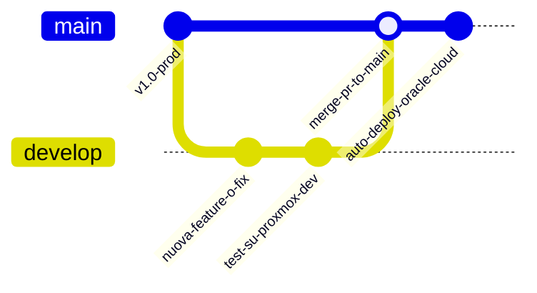

# Guida all'Ambiente di Sviluppo Locale (Proxmox VE)

Questo documento descrive l'architettura, la configurazione e il flusso di lavoro operativo per l'ambiente di sviluppo locale (**DEV**) di Expense Tracker, ospitato sul server casalingo Proxmox VE.

---

## 1. Mappa delle Risorse di Rete

| Componente | Ruolo | Indirizzo / URL | Credenziali / Note |
|---|---|---|---|
| **Proxmox VE Web UI** | Hypervisor Host (Lenovo ThinkPad) | `https://192.168.1.240:8006` | Utente `root` |
| **Proxmox Host SSH** | Accesso shell host | `ssh root@192.168.1.240` | Autenticazione SSH Key Ed25519 |
| **LXC Container (CT 100)** | Ambiente DEV dedicato (`expense-dev`) | `ssh root@192.168.1.6` | Autenticazione SSH Key Ed25519 |
| **Frontend Web (DEV)** | Interfaccia utente React + Nginx | `http://192.168.1.6:3000` | Accessibile da browser su LAN |
| **API Gateway (DEV)** | Gateway REST & Auth JWT | `http://192.168.1.6:8085` | Reverse proxied anche da `:3000/api/` |
| **RabbitMQ Management UI** | Broker messaggi asincroni | `http://192.168.1.6:15672` | `expense_user` / `expense_pass` |
| **PostgreSQL (DEV)** | Database locale containerizzato | `192.168.1.6:5432` | DB: `expense_tracker`, user: `expense_user` |

---

## 2. Architettura: DEV vs PRODUZIONE

| Aspetto | Ambiente DEV (Proxmox Locale) | Ambiente PRODUZIONE (Cloud) |
|---|---|---|
| **Hosting Principale** | LXC 100 su ThinkPad (`192.168.1.6`) | VM Ubuntu 24.04 su Oracle Cloud (`84.8.253.31`) |
| **Frontend** | Nginx containerizzato su porta `3000` | Vercel Serverless CDN (`https://...vercel.app`) |
| **Database** | PostgreSQL 17 Alpine locale (`postgres:17-alpine`) | Neon Cloud PostgreSQL (Serverless autoscaling) |
| **Message Broker** | RabbitMQ 4 Alpine locale (`rabbitmq:4-management`) | CloudAMQP (Managed RabbitMQ) |
| **Branch Git** | `develop` | `main` |
| **Immagini Docker** | Tag `:dev` (o build locale da sorgenti) | Tag `:latest` (GitHub Packages GHCR) |
| **Autonomia Dati** | Spese e categorie isolate, azzerabili senza rischi | Dati contabili reali e persistenti |

---

## 3. Ottimizzazioni Hardware sul ThinkPad (Proxmox Host)

Per garantire un funzionamento 24/7 silenzioso, affidabile e senza usura prematura della batteria del portatile:

### A. Chiusura Coperchio (Lid Switch)
Disattivata la sospensione automatica alla chiusura dello schermo:
- File configurazione: `/etc/systemd/logind.conf.d/disable-lid-switch.conf`
- Proprietà: `HandleLidSwitch=ignore`, `HandleLidSwitchExternalPower=ignore`
- Servizio: `systemd-logind`

### B. Protezione Doppia Batteria (Dual-Battery Thresholds)
Il ThinkPad dispone di tecnologia *Bridge Battery* (`BAT0` interna, `BAT1` esterna). Per prevenire il degrado chimico da carica continua al 100%:
- Soglia di avvio ricarica: **75%** (`charge_control_start_threshold`)
- Soglia di arresto ricarica: **80%** (`charge_control_end_threshold`)
- Persistenza garantita via Udev: `/etc/udev/rules.d/99-battery-charge-thresholds.rules` e servizio `battery-charge-threshold.service`.

---

## 4. Perché un Container LXC invece di una VM?

Un container **LXC (Linux Containers)** condivide il kernel Linux con l'host Proxmox, evitando l'overhead della virtualizzazione completa (QEMU/KVM):
1. **Consumo di RAM minimo**: Nessun kernel o sistema operativo duplicato in memoria. L'intero stack di 7 container Docker (4 servizi Java Spring Boot, Postgres 17, RabbitMQ 4 e Nginx) richiede solo ~3.4 GiB di RAM totale su 16 GiB disponibili.
2. **Accesso diretto alle performance del disco NVMe**: Velocità di I/O nativa senza strati di emulazione.
3. **Nesting Docker abilitato**: Il container LXC ha le feature `nesting=1` e `keyctl=1` abilitate, consentendo a Docker Engine di girare al suo interno in maniera completamente trasparente e sicura.

---

## 5. Flusso di Lavoro Git (Branching Model)



### Regole operative:
1. **Sviluppo Locale / Test**:
   - Lavorare sempre sul branch `develop` (o branch feature derivati da `develop`).
   - I commit su `develop` generano automaticamente su GitHub Actions le immagini con tag `:dev`.
2. **Test su Proxmox**:
   - Eseguire il pull o il build sul container LXC per testare l'impatto delle modifiche prima del rilascio.
3. **Rilascio in Produzione**:
   - Aprire una Pull Request da `develop` verso `main`.
   - Al merge su `main`, GitHub Actions compila le immagini con tag `:latest` e le distribuisce sull'infrastruttura Oracle Cloud / Vercel.

---

## 6. Comandi Operativi Utili

Tutti i comandi possono essere eseguiti direttamente dal tuo Mac via SSH verso il container di sviluppo:

### Verificare lo stato dei container:
```bash
ssh root@192.168.1.6 "docker ps"
```

### Consultare i log in tempo reale:
```bash
# Log dell'Expense Service
ssh root@192.168.1.6 "docker logs -f expense-tracker-expense-service"

# Log dell'API Gateway
ssh root@192.168.1.6 "docker logs -f expense-tracker-api-gateway"

# Log dell'Agente AI / OCR
ssh root@192.168.1.6 "docker logs -f expense-tracker-expense-agent-service"
```

### Aggiornare il codice sul server dev e ricompilare:
```bash
ssh root@192.168.1.6 "cd /opt/expense-tracker && git pull origin develop && docker compose up -d --build"
```

### Connettersi al database PostgreSQL locale via shell:
```bash
ssh root@192.168.1.6 "docker exec -it expense-tracker-postgres psql -U expense_user -d expense_tracker"
```

### Riavviare o fermare lo stack:
```bash
# Riavvio rapido
ssh root@192.168.1.6 "cd /opt/expense-tracker && docker compose restart"

# Stop completo
ssh root@192.168.1.6 "cd /opt/expense-tracker && docker compose down"

# Avvio in background
ssh root@192.168.1.6 "cd /opt/expense-tracker && docker compose up -d"
```
