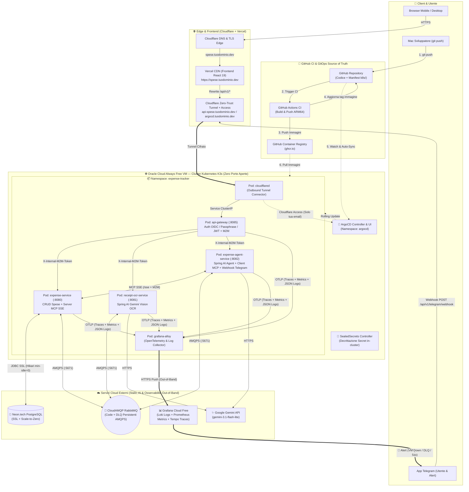
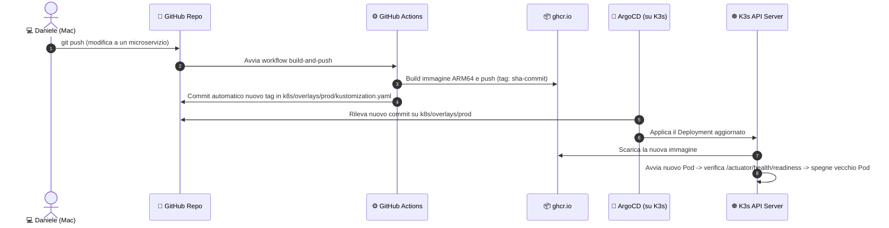

# Architettura Cloud di Produzione (K3s + ArgoCD GitOps + Grafana Cloud Observability)

Documentazione tecnica completa dell'infrastruttura cloud distribuita per **Expense Tracker** (Java 25 LTS + Spring Boot 4.1 + Spring AI 2.0 + React 19), progettata per uso personale in mobilità con **costo infrastrutturale fisso pari a `0 €/mese`** (escluso il dominio annuale Cloudflare da `~10 €/anno` e il consumo API Google Gemini pay-per-use).

---

## 1. Panoramica dei 7 Servizi & Provider Utilizzati

L'architettura adotta il paradigma **Stateless Kubernetes Cluster + External Managed State + Out-of-Band Observability**:
- Il **calcolo stateless** gira in un cluster Kubernetes **K3s** su Oracle Cloud gestito in **GitOps da ArgoCD**.
- Lo **stato persistente** vive fuori dal cluster su **Neon.tech** (PostgreSQL) e **CloudAMQP** (RabbitMQ + DLQ).
- L'**osservabilità e il monitoraggio** vivono fuori da Oracle Cloud su **Grafana Cloud**, così anche un'eventuale caduta totale della VM Oracle viene immediatamente rilevata e notificata su Telegram.

| Provider / Tecnologia | Piano Utilizzato | Costo | Ruolo nell'Architettura | Cosa Ospita / Gestisce |
| :--- | :--- | :--- | :--- | :--- |
| **1. Cloudflare** | Free Plan + Registrar | `0 €/mese` (`~10 €/anno` dominio) | DNS, Certificati TLS Edge, Zero-Trust Tunnel (`cloudflared`), Cloudflare Access | • Dominio principale (`tuodominio.dev`)<br>• Frontend (`spese.tuodominio.dev`)<br>• API Gateway (`api-spese.tuodominio.dev`)<br>• UI ArgoCD protetta (`argocd.tuodominio.dev`) |
| **2. Vercel** | Hobby (Free) | `0 €/mese` | Hosting Frontend React 19 SPA + Edge Reverse Proxy (`/api/*`) | • Build statica di [`frontend/`](file:///Users/daniele/Dev/expense-tracker-project/frontend)<br>• Regole `rewrites` same-origin verso l'API Gateway |
| **3. GitHub Actions & GHCR** | Free Tier | `0 €/mese` | Pipeline CI + Container Registry (`ghcr.io`) + Source of Truth GitOps | • Build multi-stage dei 4 microservizi Java 25<br>• Immagini Docker `linux/arm64` su `ghcr.io`<br>• Manifest Kubernetes nella cartella `k8s/` |
| **4. Oracle Cloud (OCI)** | Always Free (ARM Ampere A1: 4 OCPU, 24 GB RAM) | `0 €/mese` per sempre | Cluster Kubernetes **K3s** Stateless + **ArgoCD** | • Control Plane + Worker Node **K3s**<br>• **ArgoCD** + **Bitnami SealedSecrets**<br>• Pod dei 4 microservizi + `cloudflared` + `grafana-alloy` |
| **5. Neon.tech** | Free Tier (Serverless Postgres) | `0 €/mese` | Database Relazionale Persistente con Auto-Suspend (Scale-to-Zero) | • Database PostgreSQL (`expense_tracker`)<br>• Migrazioni Flyway (`V1__create_expenses_table.sql`) |
| **6. CloudAMQP** | Little Lemur (Free) | `0 €/mese` | Message Broker RabbitMQ Gestito e Persistente (`AMQPS`) | • Exchange `expense.tracker.exchange` e `expense.tracker.dlx`<br>• Code operative e Dead Letter Queues (`*.dlq`) |
| **7. Grafana Cloud** | Free Forever Plan | `0 €/mese` | Osservabilità Esterna Out-of-Band (Log, Metriche, Traces, Alerting) | • **Grafana Loki** (50 GB/mese Log JSON + `traceId`)<br>• **Grafana Prometheus/Mimir** (10k serie metriche)<br>• **Grafana Tempo** (50 GB/mese Traces OpenTelemetry)<br>• **Alertmanager** collegato al Bot Telegram |

> [!IMPORTANT]
> **Tripla Resilienza Architetturale**:
> 1. **Zero perdita dati**: Database (**Neon.tech**) e code/DLQ (**CloudAMQP**) sono esterni alla VM Oracle.
> 2. **Ricostruzione cluster in 5 minuti**: l'intero stato del cluster K3s è dichiarato su Git nella cartella `k8s/` e sincronizzato da **ArgoCD**.
> 3. **Monitoraggio immune ai disservizi di Oracle**: poiché **Grafana Cloud** risiede su infrastruttura esterna, se la VM di Oracle Cloud si blocca o perde connettività, Grafana Cloud rileva il mancato invio di metriche (`up == 0`) e ti invia subito un allarme su Telegram.

---

## 2. Diagramma Architetturale End-to-End



---

## 3. Orchestrazione Kubernetes (K3s) e GitOps con ArgoCD

### 3.1 Perché K3s sulla VM Oracle Cloud Always Free
La VM ARM Ampere A1 di Oracle Cloud mette a disposizione **4 OCPU e 24 GB di RAM** gratuiti per sempre.
Installando **K3s** (distribuzione Kubernetes leggera certificata CNCF):
- Il control plane di K3s occupa appena **~450 MB di RAM**, lasciando oltre **22 GB di RAM** disponibili per i pod applicativi.
- Tutti i servizi comunicano tramite DNS interno Kubernetes (`http://expense-service.expense-tracker.svc.cluster.local:8080`).
- **Zero-Downtime Rolling Updates**: durante ogni aggiornamento, K3s avvia il nuovo pod, attende che la *Readiness Probe* (`/actuator/health/readiness`) risponda `200 OK` e solo allora termina il vecchio pod senza interrompere le richieste in corso.
- **Self-Healing**: se un microservizio si blocca, la *Liveness Probe* (`/actuator/health/liveness`, già abilitata nei file `application.yml`) forza il riavvio automatico del contenitore.

### 3.2 Struttura della Cartella `k8s/` (Kustomize)
Nel repository verrà mantenuta una struttura dichiarativa pulita letta da ArgoCD:

```text
k8s/
├── base/
│   ├── kustomization.yaml
│   ├── namespace.yaml
│   ├── api-gateway/
│   │   ├── deployment.yaml
│   │   └── service.yaml
│   ├── expense-service/
│   │   ├── deployment.yaml
│   │   └── service.yaml
│   ├── receipt-ocr-service/
│   │   ├── deployment.yaml
│   │   └── service.yaml
│   ├── expense-agent-service/
│   │   ├── deployment.yaml
│   │   └── service.yaml
│   ├── cloudflared/
│   │   └── deployment.yaml
│   └── observability/
│       ├── alloy-configmap.yaml
│       └── alloy-deployment.yaml
└── overlays/
    └── prod/
        ├── kustomization.yaml
        ├── configmap-env.yaml
        └── sealed-secrets.yaml
```

### 3.3 Gestione Sicura dei Segreti su Git: Bitnami SealedSecrets
Poiché con ArgoCD l'intero stato del cluster risiede nel repository Git, le chiavi sensibili (`GEMINI_API_KEY`, password di Neon e CloudAMQP, `INTERNAL_M2M_SECRET`, `TELEGRAM_BOT_TOKEN`) **non vengono mai salvate in chiaro**:
1. Sul tuo Mac usi la CLI `kubeseal` per cifrare i segreti con la chiave pubblica del controller `SealedSecrets` installato nel tuo K3s.
2. Il file `sealed-secrets.yaml` risultante può essere committato in sicurezza su Git (è crittografato asimmetricamente).
3. Solo il controller `SealedSecrets` dentro il tuo cluster K3s su Oracle possiede la chiave privata per decifrarlo e trasformarlo in un normale `Secret` Kubernetes iniettato nei pod.

### 3.4 Ciclo di Vita di un Deploy GitOps



### 3.5 Accesso Protetto alla Dashboard di ArgoCD
La Web UI di ArgoCD non viene esposta su porte pubbliche della VM Oracle, ma viene pubblicata tramite lo stesso tunnel Cloudflare su `https://argocd.tuodominio.dev` e protetta a monte da **Cloudflare Zero Trust Access**:
- Chiunque provi ad aprire `https://argocd.tuodominio.dev` viene intercettato sull'Edge di Cloudflare e deve autenticarsi con la tua email personale prima ancora che un singolo pacchetto raggiunga il cluster K3s.

---

## 4. Osservabilità Out-of-Band: Logging, Metriche, Tracing e Alerting (Grafana Cloud)

### 4.1 Perché l'Osservabilità deve essere Esterna a Oracle Cloud
Se installassimo Prometheus, Loki e Grafana solo dentro la VM Oracle e la VM andasse in *Out-Of-Memory*, si bloccasse o avesse un disservizio di rete nel datacenter Oracle:
1. Perderesti l'accesso alla dashboard di monitoraggio proprio nel momento in cui ti serve capire cosa è successo;
2. Il sistema di alerting morirebbe insieme alla VM e non potrebbe avvisarti.

Usando **Grafana Alloy** (un singolo pod leggerissimo da ~50 MB di RAM dentro K3s) che spedisce in tempo reale telemetria e log verso **Grafana Cloud (Free Tier Forever)**:
- Se un microservizio crasha, gli ultimi log prima del crash sono già salvi su Grafana Cloud.
- Se l'intera VM Oracle muore o perde rete, **Grafana Cloud** vede interrompersi il flusso di metriche (`absent(up{cluster="oracle-k3s"})`) e ti invia immediatamente una notifica sul tuo **Bot Telegram**.

---

### 4.2 I 3 Pilastri OpenTelemetry nei 4 Microservizi Spring Boot

Tutti e 4 i microservizi ([`api-gateway`](file:///Users/daniele/Dev/expense-tracker-project/services/api-gateway/pom.xml), [`expense-service`](file:///Users/daniele/Dev/expense-tracker-project/services/expense-service/pom.xml), [`receipt-ocr-service`](file:///Users/daniele/Dev/expense-tracker-project/services/receipt-ocr-service/pom.xml), [`expense-agent-service`](file:///Users/daniele/Dev/expense-tracker-project/services/expense-agent-service/pom.xml)) vengono strumentati con lo standard **Micrometer + OpenTelemetry**:

1. **Distributed Tracing (`Grafana Tempo`)**:
   - Dipendenze: `micrometer-tracing-bridge-otel` + `opentelemetry-exporter-otlp`.
   - Ogni richiesta in ingresso su `api-gateway` riceve un **`traceId`** univoco (standard W3C `traceparent`) che viene propagato automaticamente:
     - nelle chiamate HTTP interne verso i microservizi;
     - nelle sessioni MCP SSE tra `expense-agent-service` ed `expense-service`;
     - negli header AMQP dei messaggi pubblicati e consumati su **CloudAMQP (RabbitMQ)**.
   - Su Grafana puoi visualizzare il **Service Graph** completo e il diagramma a cascata (Waterfall) con i tempi esatti di ogni salto (Gateway $\rightarrow$ Agent $\rightarrow$ RabbitMQ $\rightarrow$ OCR Gemini $\rightarrow$ Expense Service $\rightarrow$ Query SQL su Neon).

2. **Logging Centralizzato Strutturato (`Grafana Loki`)**:
   - Ogni riga di log prodotta da Spring Boot è arricchita automaticamente nel MDC (*Mapped Diagnostic Context*) con:
     - `service.name` (`api-gateway`, `expense-service`, `receipt-ocr-service`, `expense-agent-service`)
     - `traceId` e `spanId`
   - Dalla sezione *Explore* di Grafana Cloud puoi filtrare i log di tutti i pod per livello (`ERROR`, `WARN`) e passare con un click dalla riga di log di errore direttamente alla traccia distribuita su **Tempo** (*Logs-to-Traces correlation*).

3. **Metriche Applicative, JVM e Infrastrutturali (`Grafana Prometheus / Mimir`)**:
   - Dipendenza: `micrometer-registry-prometheus` (o esportazione OTLP versata su Alloy).
   - Metriche raccolte:
     - Latenza (p50, p95, p99) e tasso di errore (`4xx`, `5xx`) per ogni endpoint REST;
     - Uso RAM Heap/Non-Heap della JVM Java 25, Garbage Collector e Virtual Threads;
     - Stato del pool HikariCP verso **Neon.tech** (connessioni attive, tempi di acquisizione al risveglio dallo scale-to-zero);
     - Metriche consumer RabbitMQ e conteggio messaggi nelle **Dead Letter Queues (`*.dlq`)**.

---

### 4.3 Regole di Alerting Automatico su Telegram

Grafana Cloud Alerting dispone dell'integrazione nativa con **Telegram** (usando il tuo `TELEGRAM_BOT_TOKEN` e il tuo `chat_id`):

| Nome Regola Alert | Condizione Monitorata | Notifica che ricevi su Telegram |
| :--- | :--- | :--- |
| **1. Cluster / VM Oracle Offline** | `absent(up{job=~".*expense.*"})` per `> 2m` | 🚨 *"Attenzione: Il cluster K3s su Oracle Cloud non invia metriche da 2 minuti (VM irraggiungibile)."* |
| **2. Pod Microservizio Down / CrashLoop** | `up == 0` o riavvii pod `> 2` in `10m` | ⚠️ *"Il servizio `receipt-ocr-service` è DOWN o in CrashLoopBackOff su K3s."* |
| **3. Messaggio finito in DLQ (RabbitMQ)** | `rabbitmq_queue_messages{queue=~".*\\.dlq"} > 0` | 🐇 *"È presente almeno 1 messaggio fallito nella Dead Letter Queue su CloudAMQP."* |
| **4. Picco Errori HTTP 5xx** | `rate(http_server_requests_seconds_count{status=~"5.."}[5m]) > 0` | 🔥 *"Rilevati errori HTTP 500 sull'API Gateway o sui microservizi."* |

---

## 5. Dettaglio Configurazione Database (Neon.tech) e Broker (CloudAMQP)

### 5.1 Ottimizzazione Neon.tech per non consumare le Compute Hours Gratuite
Il piano gratuito di **Neon.tech** offre **~190 ore/mese di calcolo attivo** e sospende il database dopo 5 minuti di inattività (*Scale-to-Zero*).
Poiché i pod su K3s sono sempre accesi 24/7 (720 ore/mese), il pool **HikariCP** di [`expense-service`](file:///Users/daniele/Dev/expense-tracker-project/services/expense-service/src/main/resources/application.yml) viene configurato con **`minimum-idle: 0`**:
- Quando non usi l'app per 2 minuti (`idle-timeout: 120000`), `expense-service` chiude tutte le connessioni SQL aperte.
- Dopo 5 minuti di assenza di connessioni, Neon va in sospensione consumando **`0 ore di compute`**.
- Alla prima nuova richiesta (da web o dal Bot Telegram), HikariCP apre una connessione on-demand (`connection-timeout: 20000`), risvegliando Neon in `~400 ms`.

### 5.2 Persistenza Code e DLQ su CloudAMQP
I 3 microservizi che utilizzano RabbitMQ (`expense-service`, `receipt-ocr-service`, `expense-agent-service`) si collegano via **AMQPS (TLS su porta `5671`)** all'istanza gratuita *Little Lemur* di **CloudAMQP**:
- **Exchange principale**: `expense.tracker.exchange` (`durable = true`)
- **Dead Letter Exchange**: `expense.tracker.dlx` (`durable = true`)
- **Code e DLQ persistenti**:
  - `expense.create.queue` $\rightarrow$ `expense.create.dlq`
  - `receipt.ocr.job.queue` $\rightarrow$ `receipt.ocr.job.dlq`
  - `agent.command.job.queue` $\rightarrow$ `agent.command.job.dlq`

---

## 6. Mappa Completa delle Variabili e dei Segreti di Produzione

### 6.1 Su Vercel (Project Settings $\rightarrow$ Environment Variables)
| Variabile | Valore | Scopo |
| :--- | :--- | :--- |
| `VITE_GOOGLE_CLIENT_ID` | `<tuo-id>.apps.googleusercontent.com` | Abilita il pulsante ufficiale "Accedi con Google" nella [`LoginPage.tsx`](file:///Users/daniele/Dev/expense-tracker-project/frontend/src/features/auth/components/LoginPage.tsx) |

### 6.2 Nel Cluster K3s (ConfigMap + SealedSecrets in `k8s/overlays/prod/`)
| Variabile | Tipo K8s | Servizi che la usano | Descrizione |
| :--- | :--- | :--- | :--- |
| `CLOUDFLARE_TUNNEL_TOKEN` | `SealedSecret` | `cloudflared` | Token del tunnel Cloudflare Zero Trust |
| `ALLOWED_USER_EMAIL` | `ConfigMap` | `api-gateway` | La tua email personale autorizzata per il login Google OIDC |
| `GOOGLE_OIDC_CLIENT_ID` | `ConfigMap` | `api-gateway` | Client ID OAuth 2.0 configurato su Google Cloud Console |
| `GATEWAY_ACCESS_PASSPHRASE` | `SealedSecret` | `api-gateway` | Passphrase personale di accesso rapido |
| `GATEWAY_JWT_SECRET` | `SealedSecret` | `api-gateway` | Segreto HMAC-SHA256 ($\ge 32$ caratteri) per firmare i JWT |
| `INTERNAL_M2M_SECRET` | `SealedSecret` | Tutti i 4 microservizi | Segreto condiviso per l'header `X-Internal-M2M-Token` |
| `M2M_AUTH_ENABLED` | `ConfigMap` | `expense`, `ocr`, `agent` | `true` (rifiuta qualsiasi chiamata priva del token M2M) |
| `POSTGRES_URL` | `SealedSecret` | `expense-service` | `jdbc:postgresql://<host>.neon.tech:5432/<db>?sslmode=require` |
| `POSTGRES_USER` | `SealedSecret` | `expense-service` | Utente database Neon.tech |
| `POSTGRES_PASSWORD` | `SealedSecret` | `expense-service` | Password database Neon.tech |
| `RABBITMQ_HOST` | `ConfigMap` | `expense`, `ocr`, `agent` | Host del cluster CloudAMQP |
| `RABBITMQ_PORT` | `ConfigMap` | `expense`, `ocr`, `agent` | `5671` (AMQPS TLS) |
| `RABBITMQ_VHOST` | `ConfigMap` | `expense`, `ocr`, `agent` | Virtual host assegnato da CloudAMQP |
| `RABBITMQ_USER` | `SealedSecret` | `expense`, `ocr`, `agent` | Utente CloudAMQP |
| `RABBITMQ_PASSWORD` | `SealedSecret` | `expense`, `ocr`, `agent` | Password CloudAMQP |
| `RABBITMQ_SSL_ENABLED` | `ConfigMap` | `expense`, `ocr`, `agent` | `true` |
| `GEMINI_API_KEY` | `SealedSecret` | `ocr`, `agent` | Chiave API Google AI Studio (`GEMINI_API_KEY`) |
| `TELEGRAM_BOT_TOKEN` | `SealedSecret` | `expense-agent-service` | Token fornito da `@BotFather` |
| `TELEGRAM_WEBHOOK_SECRET` | `SealedSecret` | `expense-agent-service` | Segreto verificato nell'header `X-Telegram-Bot-Api-Secret-Token` |
| `TELEGRAM_ALLOWED_USER_IDS` | `ConfigMap` | `expense-agent-service` | Il tuo User ID numerico Telegram personale |
| `GRAFANA_CLOUD_OTLP_ENDPOINT` | `ConfigMap` | `grafana-alloy` | Endpoint OTLP Gateway della tua istanza Grafana Cloud Free |
| `GRAFANA_CLOUD_API_TOKEN` | `SealedSecret` | `grafana-alloy` | Token di autenticazione per inviare Log, Metriche e Traces a Grafana Cloud |

---

## 7. Roadmap Operativa per l'Implementazione e il Deploy

Quando deciderai di passare all'implementazione sul codice e al deploy, procederemo in **5 fasi ordinate**:

1. **Fase 1 — Strumentazione Osservabilità & Adattamento Cloud nei Microservizi**:
   - Aggiunta dipendenze **Micrometer Prometheus + OpenTelemetry Tracing (`traceId`/`spanId`)** nel [`pom.xml`](file:///Users/daniele/Dev/expense-tracker-project/pom.xml) padre e nei 4 microservizi.
   - Aggiornamento [`application.yml`](file:///Users/daniele/Dev/expense-tracker-project/services/expense-service/src/main/resources/application.yml) per **Neon.tech** (`POSTGRES_URL` + HikariCP `minimum-idle: 0`) e per **CloudAMQP** (`RABBITMQ_VHOST` + `RABBITMQ_SSL_ENABLED`).
2. **Fase 2 — Creazione Manifest Kubernetes (`k8s/`), Grafana Alloy e Pipeline GitHub Actions**:
   - Creazione della struttura Kustomize `k8s/base` e `k8s/overlays/prod` (Deployment con Liveness/Readiness probes, Service, ConfigMap, Grafana Alloy).
   - Creazione del workflow `.github/workflows/ci-gitops.yml` per compilare e pubblicare le immagini ARM64 su `ghcr.io` e aggiornare i tag per ArgoCD.
   - Creazione di `frontend/vercel.json` per l'Edge Rewrite verso l'API Gateway.
3. **Fase 3 — Setup Servizi Cloud Esterni (Neon.tech, CloudAMQP, Grafana Cloud)**:
   - Creazione DB su **Neon.tech**, istanza *Little Lemur* su **CloudAMQP** e stack gratuito su **Grafana Cloud** con Contact Point Telegram per gli alert.
4. **Fase 4 — Bootstrap K3s + ArgoCD + SealedSecrets + Cloudflare Tunnel sulla VM Oracle**:
   - Installazione di **K3s**, **ArgoCD** e **SealedSecrets** sulla VM Oracle Cloud Always Free.
   - Configurazione del tunnel Cloudflare (`api-spese.tuodominio.dev` e `argocd.tuodominio.dev` protetto da Cloudflare Access) e aggancio del repository Git ad ArgoCD.
5. **Fase 5 — Deploy Frontend su Vercel e Attivazione Webhook Telegram**:
   - Deploy automatico di [`frontend/`](file:///Users/daniele/Dev/expense-tracker-project/frontend) su Vercel (`spese.tuodominio.dev`) e registrazione del Webhook Telegram su `https://api-spese.tuodominio.dev/api/v1/telegram/webhook`.
